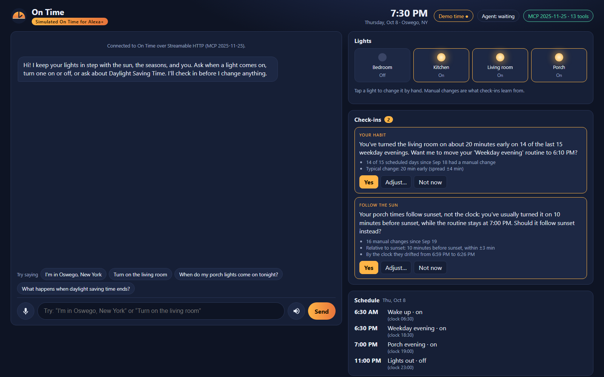

# On Time

**An Alexa+ tool that keeps your lights in step with the sun, the seasons, and you.**

On Time is a Model Context Protocol (MCP) server for smart lights. It follows MCP spec 2025-11-25
over Streamable HTTP, is written in Python, and can use Claude on Amazon Bedrock.

> Twice a year the clocks jump an hour, and every fall evening arrives a little sooner, but your
> lights don't notice. On Time does.

**Watch the demo video:** [youtu.be/rbvQR9fK9XE](https://youtu.be/rbvQR9fK9XE)



Built for the *Build, Ship, Shape: Amazon Developer Hackathon*, **Alexa+ track**, with the
**AWS Builder** mini challenge.

## What it does
On Time gives Alexa+ the tools to run your lights (on and off) on a smarter schedule.

- **It follows the sun.** A routine can run at sunrise or sunset where you live. Your location comes
  from the device or from a city you name ("I'm in Oswego, New York").
- **It glides through Daylight Saving Time.** Before the clocks change, routines move 15 minutes a day
  for 4 days, so Sunday isn't a one-hour jolt.
- **It learns from you, then asks.** If you keep turning a light on early, On Time notices and asks,
  with the evidence: "about 20 minutes early on 14 of the last 15 weekday evenings." You can say yes,
  adjust it ("yes, but 15 minutes before"), or say no (it won't ask again for 14 days).
- **It explains every time.** "Wake up comes on at 7:00 AM: it's set for 6:30 AM, and it's 30
  minutes later to ease into the clock change."
- **It never changes anything without a yes.**

## How it reaches Alexa+
Amazon's Alexa+ add-on tools (the MCP Toolkit, the `alexa-ai` CLI, and the simulator) are a preview
for select partners only, so a web page that acts as a real MCP client to test the concept.

The demo runs in **Simulated On Time for Alexa+**, a page labelled that way on screen. It is a real
MCP client in the browser (`initialize`, then `tools/list`, then `tools/call`, over Streamable HTTP),
with voice and chat. Its **MCP protocol** panel shows every message as it happens. Claude
Haiku 4.5 on Amazon Bedrock chooses which tools to call; an offline agent runs the same demo without AWS.

```
Simulated On Time for Alexa+ (browser)
  ├─ MCP client ── Streamable HTTP, 2025-11-25 ──►  On Time MCP server (13 tools)
  └─ asks /agent for the next step: Claude Haiku 4.5 on Bedrock  |  offline agent
On Time server: schedule (clock / sunrise-sunset + DST glide + confirmed changes)
                · pattern detectors → check-ins · SQLite · demo clock
```

### On-screen cards (MCP Apps)
For screens like the Echo Show, On Time includes two interactive cards, built as
[MCP Apps](https://apps.extensions.modelcontextprotocol.io/) `ui://` resources:

- a **check-in card** with Yes, Adjust…, and Not now buttons (shown for `get_checkins`);
- a **schedule and Daylight Saving timeline** with an "Ease me in" button (shown for `get_schedule`
  and `plan_dst_transition`).

The demo page shows each card in a sandboxed frame on a separate web address. A card's buttons call
On Time's tools through the page, and the card tells the assistant what happened. Hosts without MCP
Apps still get the same answers as text.

## How each light time is calculated
```
time today = base time      clock time, or sunrise/sunset at home ± minutes
           + DST glide      4 days × 15 minutes before a clock change (clock-based routines only)
           + your change    an offset you confirmed in a check-in
```

- **Base time.** Sunrise and sunset come from the home's location and are worked out each day with
  `astral`, using the standard −0.833° sun angle. The location also sets the time zone, which sets
  the Daylight Saving dates.
- **Daylight Saving glide.** Before the clocks fall back (Sunday, Nov 1, 2026 in the US), clock-based
  routines run 15, 30, 45, then 60 minutes later from Wednesday to Saturday, then land on the new
  clock. Springing forward works the same way in reverse. Routines that follow the sun don't need it.
  On Time offers the glide in a check-in and never applies it on its own.
- **Your change.** Every time you switch a light by hand, On Time records how far it was from the
  routine. Pattern detectors spot a steady habit, or a routine that should follow sunset instead of
  the clock, and turn it into a check-in with the evidence.

**Design choices**
- Lights only, on and off: easy to demo, and easy to connect to real lights later.
- Nothing changes without a yes.
- Check-ins are *pulled*. An MCP server can't start a conversation, so everyday answers carry the
  next question for the assistant to ask.
- The connection is stateless; the home's memory lives in a SQLite database.
- All time math is done in UTC, because clock arithmetic breaks across Daylight Saving changes.

## Try it in 2 minutes
You need Python 3.12 or newer and [uv](https://docs.astral.sh/uv/). No AWS account is needed.

```bash
uv sync
uv run on-time-seed --fresh --end 2026-10-08   # a home in Oswego, NY with 30 days of light history
uv run on-time                                 # the server, at http://127.0.0.1:8000/mcp
```

Turn on the demo clock before starting the server: in Windows PowerShell run
`$env:ON_TIME_DEMO = "1"`; on macOS or Linux use `ON_TIME_DEMO=1 uv run on-time`.

If Windows blocks `on-time` or `on-time-seed` ("An Application Control policy has blocked this
file"), run the same commands through Python instead: `uv run python -m on_time.seed --fresh --end
2026-10-08` and `uv run python -m on_time`.

Open **http://127.0.0.1:8000/** in Chrome or Edge (needed for the microphone; typing works in any
browser) and try:

1. Click **Demo time → Oct 8 · evening** (the sample history ends that day).
2. Say *"I'm in Oswego, New York"*.
3. Say *"Turn on the living room"*. On Time answers, then asks about your 20-minutes-early habit.
4. Say *"Yes, but 15 minutes before"* (or use the card: **Adjust…**, `-15`, **Save**), then *"Yes"*
   to the porch question.
5. Say *"Turn the bedroom off at 11:30 PM on weekdays"*, then *"What routines do I have?"*
6. Say *"When do my porch lights come on tonight?"*
7. Click **Demo time → Oct 26 · DST week**, say *"What happens when daylight saving time ends?"*, then
   click **Yes** in the card.
8. Click **Demo time → Oct 29**, then say *"Why does the bedroom light come on when it does?"*

**Other demo homes.** Seed one of these instead, then use **Demo time → Jump to** for its dates:
- `uv run on-time-seed --fresh --city Scottsdale --region AZ`: Arizona never changes its clocks,
  so there's nothing to glide.
- `uv run on-time-seed --fresh --city London --region UK`: the clocks fall back on Oct 25, 2026.
- `uv run on-time-seed --fresh --city Sydney --region Australia`: the clocks fall back on Apr 4, 2027.

**Run the tests** with `uv run python -m pytest`. All 215 tests cover:
- MCP spec compliance, checked against a running server, plus an end-to-end run with the official
  MCP Python client (see [spec compliance](docs/spec-compliance.md));
- sun times against reference data, and Daylight Saving edge cases;
- full Daylight Saving conversations, with clocks going back and going forward;
- the pattern detectors, whole conversations, the cards, and the Bedrock agent (with a stand-in for
  Bedrock, so tests never call AWS).

## Use Claude on Amazon Bedrock (optional)
With Bedrock turned on, **Claude Haiku 4.5** decides which On Time tools to call (Converse API with
tool use, in us-east-2). Each MCP tool becomes a Bedrock tool, the page makes every call over MCP, and
the results go back to Claude for the reply. On Time only accepts tool calls it offered, and if
Bedrock has any problem, the offline agent takes over so the demo never stalls. The full write-up,
including what live testing taught us, is in [docs/aws.md](docs/aws.md).

To use it, sign in with an AWS account that has Bedrock access to Anthropic's Claude:

```bash
aws login --profile <your-profile>
```

Then start the server with `AWS_PROFILE=<your-profile>` and `ON_TIME_AGENT=bedrock`. The header
shows which agent answered.

## MCP tools
- **`set_location`, `get_location`:** set the home from a city or device coordinates; this also sets
  the time zone. If a city name is ambiguous, the choices come back to ask about.
- **`list_lights`, `set_light`:** see and switch lights. Each manual change is recorded against the
  routine it differed from.
- **`add_routine`, `list_routines`, `remove_routine`:** routines at a clock time or relative to
  sunrise or sunset, on chosen days.
- **`get_schedule`, `explain_light_time`:** when each light runs, and why, factor by factor.
- **`plan_dst_transition`:** the next Daylight Saving change and the 4 × 15-minute glide.
- **`get_checkins`, `respond_to_checkin`:** the conversational check-ins: accept, adjust, or decline.
- **`set_demo_clock`:** time travel for demos (only when `ON_TIME_DEMO=1`).

Any MCP client can use On Time. For example, in
[MCP Inspector](https://github.com/modelcontextprotocol/inspector) choose transport
`streamable-http` and URL `http://127.0.0.1:8000/mcp`.

## Settings
All settings are environment variables, and all are optional.

- **`ON_TIME_HOST`, `ON_TIME_PORT`:** where the server listens. Default `127.0.0.1` and `8000`
  (this computer only).
- **`ON_TIME_DB`:** the SQLite file for the home's location, lights, routines, history, and
  check-ins. Default `on_time.db`.
- **`ON_TIME_API_TOKEN`:** a password (bearer token) required on `/mcp` and `/agent`. Without one,
  the server only accepts connections from this computer.
- **`ON_TIME_ALLOWED_ORIGINS`:** extra web addresses allowed to connect from a browser.
- **`ON_TIME_DEMO`:** set to `1` to turn on the demo clock. Off by default.
- **`ON_TIME_AGENT`:** `mock` (the offline agent, the default) or `bedrock` for Claude on Amazon Bedrock.
- **`ON_TIME_BEDROCK_MODEL`:** the Bedrock model. Default `us.anthropic.claude-haiku-4-5-20251001-v1:0`.
- **`ON_TIME_BEDROCK_REGION`:** the Bedrock Region. Default `us-east-2`.

## More docs
- [AWS integration](docs/aws.md): how Claude on Amazon Bedrock drives the MCP tools.
- [MCP spec compliance](docs/spec-compliance.md): each 2025-11-25 requirement and the test that checks it.
- [Friction log](docs/friction-log.md): snags with AWS, Bedrock, the Alexa+ docs, and MCP tools, with
  suggestions.

## Built with
Python · MCP Python SDK · Amazon Bedrock (Claude Haiku 4.5) · Agent Toolkit for AWS · astral ·
GeoNames · SQLite · Web Speech API · Claude Code

## How it was built
On Time was built during the hackathon (starting Sep 30, 2026) by Sarah Mason, with **Claude Code**
as a pair programmer. Sarah set the product idea, the scope, and the scheduling rules (lights only,
the 4 × 15-minute glide, conversational check-ins), made the decisions at each step, and tested the
running app. Claude Code wrote most of the code, tests, and documentation under Sarah's direction.

## License
MIT. See [LICENSE](LICENSE).
